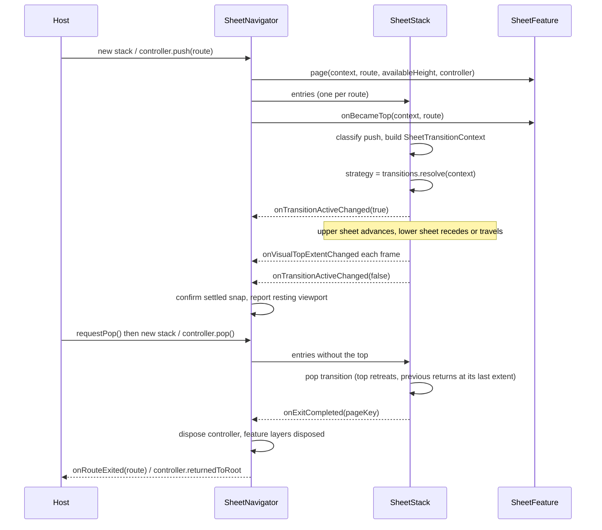

# Architecture

This guide describes the pieces of the package and how they fit together. The code samples reuse `AppRoute`, `ListRoute`, `DetailsRoute` and `AppFeature` from the [README quick start](../README.md#quick-start).

## Layers

```text
SheetNavigator                    stack diffing, callbacks, overlays, resting viewport
 |- SheetNavigatorScope           requestPop, visualTopExtent, isTransitionActive
 |   '- SheetFeature.scope(...)   per-feature wrapper (only features with live routes)
 |- overlay layers                SheetOverlayLayer / SheetFeature.layer
 '- SheetStack                    one Sheet per level, transitions, drag/scroll plumbing
     '- SheetPageContent          handle, header, scrollable body, bottom bleed
```

`SheetStack` is exported and can be used on its own with `SheetStackEntry`s, but `SheetNavigator` is the intended entry point and the only layer that knows about features, layers and the resting viewport.

## Routes

`SheetRoute` is an immutable value that names a stack entry. Equality and `hashCode` are derived from `pageKey`, which defaults to `runtimeType`.

- Routes of the same class collapse into one page unless they override `pageKey` (see `DetailsRoute` above, which keys on its id).
- A stack must have unique page keys. Both `SheetNavigator` and `SheetNavigatorController` enforce this: the navigator asserts, the controller ignores a push whose key is already deeper in the stack.
- A stack must not be empty.

## Features

A `SheetFeature<R>` is the bridge between routes and sheets. `SheetNavigator<R, F>` receives a `List<F>` and, for each route, uses the first feature whose `handles(route)` returns true. Every route needs a handling feature.

| Member | Purpose |
| --- | --- |
| `handles(route)` | Required. Whether this feature owns the route. |
| `page(context, route, availableHeight, controller)` | Required. Builds the `SheetPage`. Called on every navigator build for every route in the stack, so keep it cheap and side-effect free. `controller` is the page's own `SheetController`. |
| `scope(context, child)` | Wraps the navigator content (sheets and layers) in an inherited widget, for example to provide a bloc or notifier. Applied only while the feature has a live route or a route that is still exiting. Defaults to `child`. |
| `layer(context, layerId, route)` | The widget this feature shows in an overlay layer while `route` is on top. `null` shows nothing. |
| `layerBottom(context, layerId, route)` | Where the layer's content ends, see [overlay layers](viewport-and-overlays.md#overlay-layers). |
| `onBecameTop(context, route)` | The route became the top of the stack (push, or pop revealing it). Called when the stack changes, before the transition finishes; not called for the initial route. |
| `onAvailableHeightChanged(context, route)` | The navigator's height changed while the same route stayed on top. |
| `onSettledAfterDrag(context, route, extent)` | The top sheet settled on a snap different from the one it last settled on. Deferred until the user stops dragging or scrolling, then delivered two frames later. `extent` is the snap. |

## Pages

```dart
SheetPage(
  pageKey: route.pageKey,
  initialSize: 0.4,
  snapSizes: const [0.4, 0.9],
  builder: (context, scrollController) => ListView(controller: scrollController),
);
```

| Parameter | Meaning |
| --- | --- |
| `pageKey` | Required. Must equal the route's `pageKey`. |
| `initialSize` | Required. Extent when the page first appears, as a fraction of the navigator height. Also the extent a push transition animates towards. |
| `snapSizes` | Required. Snap points as fractions of the navigator height. The largest is the expanded extent. Dragging snaps to the nearest one. |
| `builder` | Required. A `ScrollableWidgetBuilder`: `(context, scrollController)`. Attach `scrollController` to the page's scrollable (it is also the `PrimaryScrollController` inside the body) so scrolling and dragging hand over to each other. |
| `header` | Optional `WidgetBuilder` rendered above the body, outside the scrollable. |
| `floor` | Optional [`SheetFloor`](floor.md). |
| `backgroundTopInset` | Added to the top inset of the [resting viewport](viewport-and-overlays.md#sheetrestingviewport). Default 0. |
| `pinnedExtent`, `focusExtent` | Carried on the page and preserved through floor resolution, but not read by this package. They are metadata for the host, retrievable from `SheetNavigatorScope.resolvedPageOf`. |

The page content is laid out in a box as tall as the largest snap, and the sheet slides over it. The body is inside a `SheetVisibleContentScope`; wrap content in `SheetVisibleContent` to lay it out against the part that is currently visible (for example to centre an empty state), which sizes its child to the visible height (top aligned) and re-lays it out as the sheet moves.

`SheetPageScope.snapSizesOf(context)` returns the snap sizes the page was actually built with, after floor resolution. `SheetNavigatorScope.resolvedSnapSizesOf(pageKey)` does the same by key.

### Snap states and the stop grid

`SheetSnapState.classify(extent, snapSizes)` maps an extent to one of four values, with a tolerance of `SheetSnapState.tolerance` (0.01):

| State | Condition |
| --- | --- |
| `expanded` | Extent is at the largest snap. |
| `mid` | Extent is at the largest snap that is below the expanded one (the "resting" snap). |
| `collapsed` | Extent is at the lowest snap. |
| `between` | None of the above, or `snapSizes` is empty. |

The checks run in that order, so with two snaps the lower one is `mid`, and with one snap it is `expanded`. `collapsed` is only distinct from `mid` when there are at least three snaps. Transition rules use these states.

`SheetStopGrid.resolve` is an optional helper for computing snap sizes from screen-relative targets:

```dart
final stops = SheetStopGrid.resolve(
  availableHeight: availableHeight,
  targetScreenFraction: 0.45,
  bottomBarInset: 56,
  topInset: 24,
);
// stops.floor, stops.resting, stops.expanded are fractions of availableHeight
```

- `expanded` is `1 - topInset / availableHeight` (clamped to 0..1).
- `resting` is `targetScreenFraction * (availableHeight + bottomBarInset) / availableHeight`, capped so at least 100 logical pixels remain above the sheet, then raised to at least the floor and clamped to `[floor, expanded]`.
- `floor` is `floorExtent` when given, else the same value as `resting`, and never above `expanded`.
- With `availableHeight <= 0`, `resting` is `targetScreenFraction` and `expanded` is 1.

## Navigator, scope and controller

### Declarative and controlled modes

| | `SheetNavigator(...)` | `SheetNavigator.controlled(...)` |
| --- | --- | --- |
| Stack source | `stack:` argument | `controller.stack` |
| Change detection | The `stack` list instance changed (`identical`) | `controller.stackChanges` |
| Pop requests | `onPopRequested` | `controller.pop()` |
| Exit notification | `onRouteExited(route)` | `controller.notifyRouteExited` (feeds `returnedToRoot`) |

Passing a `controller` together with `stack`, `onPopRequested` or `onRouteExited` fails an assertion. Swapping the controller on a live navigator resubscribes and applies the new controller's stack.

The navigator never pops by itself. A pop happens when a page calls `SheetNavigatorScope.maybeOf(context)?.requestPop()` (or the controller is used directly), and the host decides what to do with it.

### SheetNavigatorController

| Member | Behavior |
| --- | --- |
| `SheetNavigatorController(root: route)` | Starts with one route. |
| `stack`, `current`, `depth`, `canPop` | Read-only state. `stack` is unmodifiable. |
| `push(route)` | Same key as the current top: replaces the top silently when the route object differs (no transition). Key already deeper in the stack: ignored. Otherwise appended. |
| `pop()` | Removes the top. Returns `false` at depth 1. |
| `popToRoot()` | Removes everything above the root. No-op at depth 1. |
| `replaceTop(route)` | Replaces the top with a route of a different key (animated as a replace). Same rules as `push` for duplicate keys. |
| `stackChanges` | Broadcast `Stream<List<R>>`, one event per effective change. |
| `returnedToRoot` | Broadcast `Stream<void>`. Fires once the stack is back at the root and every route removed on the way has finished its exit animation. |
| `notifyRouteExited(route)` | Called by the navigator. Override it in tests to observe exits. |
| `dispose()` | Closes both streams. |

### SheetNavigatorScope

Found with `SheetNavigatorScope.maybeOf(context)` from pages, headers, features' scopes and layers. It exposes:

- `requestPop()`: asks the host to pop;
- `visualTopExtent`: a `ValueListenable<double?>` of the highest visible sheet extent, including mid-transition values, or `null` before the first layout;
- `isTransitionActive`: a `ValueListenable<bool>`, true while a push, pop or replace animates;
- `resolvedPageOf(pageKey)` and `resolvedSnapSizesOf(pageKey)`: the page as built by the feature, with the floor applied.

## SheetStack internals

### One sheet per level

`SheetStack` keeps one live `Sheet` (with its own `SheetController`) for each route, stacked in a `Stack`. Only the top sheet, or sheets taking part in a transition, are painted, and only the settled top sheet receives pointer events; covered sheets stay mounted, hidden, ignoring pointers and excluded from semantics. Because the covered sheet is never rebuilt from scratch, its widget state, scroll position and extent survive until it is revealed again.

During a transition each live sheet has a role:

| Role | Sheet |
| --- | --- |
| `advancing` | The new top sliding in (push, replace). |
| `receding` | The previous top while a push or replace plays: fades and scales, or travels down (see [transitions](transitions.md)). |
| `retreating` | The top sliding out (pop). |
| `returning` | The sheet revealed by a pop. |
| `idle` | Not animating. |

Each role gets its translate, opacity and scale from the `SheetTransitionStrategy` resolved for the transition. Opacity and scale are applied outside the style's `surfaceBuilder`, so the surface fades and scales as a unit.

### Stack diffing

`SheetStack` compares the previous and next lists of page keys:

| Change | Operation |
| --- | --- |
| One key appended | push |
| New list is a strict prefix of the old | pop (several sheets can leave at once; the topmost animates, the rest are removed with it) |
| Same length, only the last key differs | replace |
| Anything else (for example the bottom of the stack changed) | replace-like rebase of the top; or an immediate rebuild without motion if the old top is still in the stack or the new top already exists |

A new change arriving mid-transition finishes the running one immediately first.

### Push and pop flow



### Route exit

A removed route is not forgotten until its sheet has left the tree and, if the removed top route was its feature's last route in the stack, that feature's overlay layers have been disposed. Only then is `onRouteExited` (or `controller.notifyRouteExited`) called, and the feature's `scope` is removed if the feature has no other route. If the exit does not complete within `exitFallbackTimeout` (default 600 ms, multiplied by `timeDilation`), it is forced, so a stuck layer cannot block the callback forever.

Pushing a key that is still exiting reuses the live controller.

### Extent memory

Each page keeps its `SheetController`, so a covered page returns at the extent it was left at. The navigator additionally records, per page, the last snap the sheet confirmed at rest. That snap is used to restore the resting viewport report when a page is revealed again, and is forgotten when the page's route exits.

### Drag, scroll and physics

These pieces are wired by `SheetStack` and `SheetPageContent` and are exported for reuse.

| Piece | Behavior |
| --- | --- |
| `SheetScrolledContentDragGate` | While the sheet is below its top and the visible content is scrolled away from its start, drag gestures on the content are disabled (`dragDevices` emptied) so dragging moves the sheet only. It re-evaluates when the visible content changes, for example when a tab page becomes active (ticker mode of the scroll position). |
| `SheetContentBounce` | The default `SheetScrollConfiguration`: scroll syncing `onlyFromTop`, and it delegates unhandled overscroll to the content while the content is scrolled below its start. `track(builder)` records the body's `ScrollController`. |
| `SnapBounceSheetPhysics` | The default `SheetPhysics`: a damped spring (mass 0.5, stiffness 121, damping ratio 0.85) towards the nearest snap, with overshoot limited to about 2 px at snaps and `sheetOvershootExtent` (8 px) beyond the lowest snap. Replaced by `SheetNavigatorStyle.physics`. |
| `SheetBottomBleed` | The page box is extended below the largest snap by `sheetBottomBleedFor(viewportHeight:, contentBoxHeight:)`, clamped to 0..8 px, so the spring overshoot at the top never exposes a gap under the sheet. |
| `SheetPointerCancelGuard` | If the pointer is cancelled mid-drag (a system gesture takes over), the sheet animates back to where the drag started instead of settling wherever it was. |
| `SheetExtentBuilder` | Rebuilds with `controller.extent` (a `double?`) whenever the sheet moves. |
| `SheetControllerExtent` | Extension giving `SheetController.extent`: `metrics.offset / viewportSize.height`, or `null` before layout. |

Inactive (covered) sheets also keep the `MediaQuery` view insets and padding they had when they were last active, so a keyboard opening over the top sheet does not re-lay out the hidden ones.

### Callbacks reported by the navigator

| Callback | Value |
| --- | --- |
| `onVisualTopExtentChanged(double?)` | Same value as `SheetNavigatorScope.visualTopExtent`. |
| `onTopFullyExpandedChanged(bool)` | True while the settled top sheet is at its largest snap. Deduplicated. |
| `onSheetInteractingChanged(bool)` | True from drag start until the sheet rests on a snap, and while content inside the sheet scrolls. Reset when the set of pages changes. |
| `onRestingViewportChanged(SheetRestingViewport)` | See [viewport and overlays](viewport-and-overlays.md). |
| `onPopRequested`, `onRouteExited` | Declarative mode only. |

`sheetLayerWrapper` wraps the sheet layer (not the overlay layers) in a widget of your own, receiving a `SheetViewportState`. It rebuilds when the settled snap changes. `sheetLayerKey` keys that wrapper.
